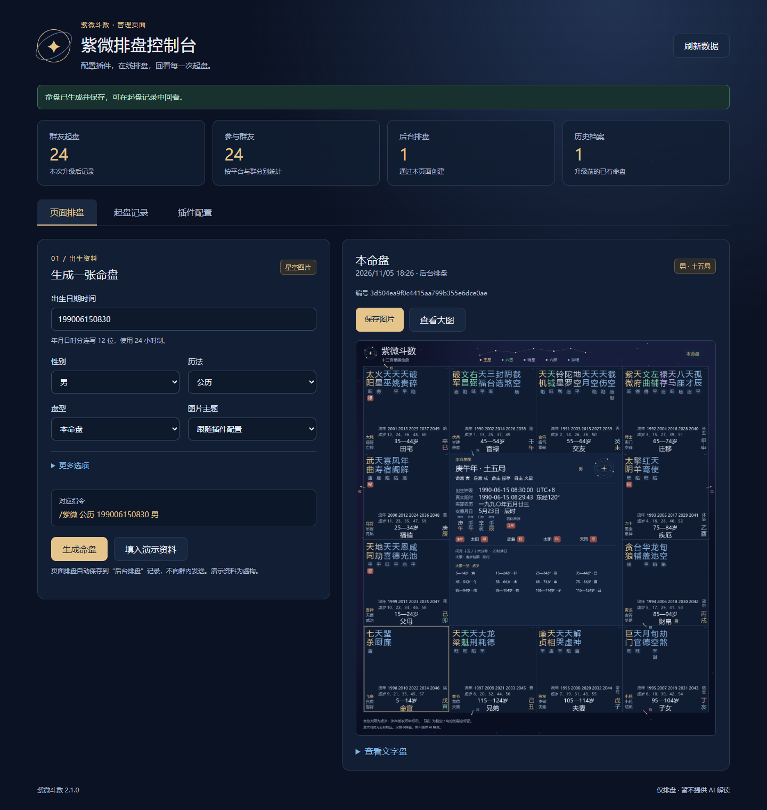
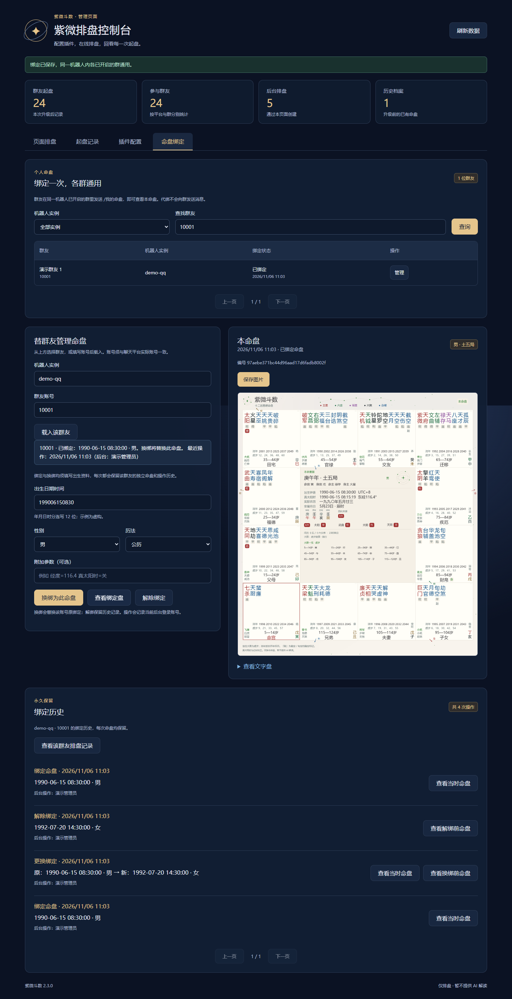

# 紫微斗数排盘

AstrBot 紫微斗数插件，版本 **2.4.1**。在已授权群内通过指令排盘、绑定自己的本命盘，返回星空风格十二宫图片；管理员可在控制台配置插件、在线排盘、查看群友记录并代管绑定。支持图片帮助、运限盘、流年盘、日期流盘和原有指令版人生图谱。

**当前支持指令与管理页面排盘，暂不提供 AI 看盘、AI 排盘或辅助定盘。** 不注册 LLM 工具、不注入对话提示、不调用模型、不启动后台总结。新排盘默认采用用户提供的寻龙者课件校勘取法；历法及课件未完整规定的算法沿用原实现。

2.4.0 按课件调整火铃、月德、解神、截空与旬空正副次序，并统一岁前“大耗”名称。图片与文字标明安星依据。课件存在少量内部异文，对可互证部分优先采用口诀与详解，无法判定的版本差异先暂取并注明，依据见[逐项校勘](references/XUNLONGZHE_REVIEW.md)。管理员可将“安星依据”改为 `wm259` 使用原版；旧绑定及历史命盘保留原结果，要按课件重排绑定请显式换绑。

2.4.1 将课件争议列入 **控制台 → 插件配置 → 课件待确认项**，显示出处、暂用依据、当前选择及未保存标记。庚干四化、巳酉丑年火铃起宫、火铃是否数生时、将前次序均可独立切换；选项标明暂用、异文备选或原版补充，全部等待老师确认。其余文字歧义和课件未明确项目可展开查看。暂用方案保持原有结果，保存仅影响之后新盘；已有绑定如需采用新方案，须重新输入资料显式换绑。

## 安装与升级

要求 Python 3.10+、AstrBot 4.24.0+。

1. 将整个目录放入 AstrBot 的 `data/plugins/astrbot_plugin_ziwei/`。
2. 在 AstrBot 使用的 Python 环境安装依赖：

   ```sh
   python -m pip install -r data/plugins/astrbot_plugin_ziwei/requirements.txt
   ```

3. 重载插件，在目标群由群主、群管理员或 AstrBot 管理员发送 `/紫微 开启`。
4. 发送 `/紫薇 help` 或 `/紫薇 帮助` 查看图片帮助，也可不留空格；`/紫薇帮助文字` 获取完整参数和可复制示例。

新安装默认 `image_theme=night`，使用深蓝星空模板。升级会保留已有主题；如果原配置为 `day`，在 WebUI 改为 `night`，或单次加 `主题=夜间`。原字体、输出、经度时区和安星规则配置继续有效。旧 AI 配额及总结模型配置已从设置面板移除，遗留配置不触发任何 AI 功能。

原命盘、图谱、读盘、反馈、定盘候选和额度记录保留在 AstrBot 数据目录的 `plugin_data/astrbot_plugin_ziwei/archives.sqlite3`。2.0.0 不恢复或推进旧 AI 总结任务，也不提供旧 AI 记录的聊天入口。更新前可停用插件并备份整个插件数据目录。旧 AI 服务源码、离线预览和存储回归仍保留供兼容维护，未接入当前插件入口。

字体继续使用常规字重中文字体：Windows 查找微软雅黑／黑体，Linux 查找 Noto CJK／文泉驿，macOS 查找苹方，也可配置 `font_path`。命盘或帮助图片生成失败时返回文字；人生图谱生成失败会提示检查字体后重试。图片通过 AstrBot 消息组件返回，不依赖浏览器、图片服务或模型。

## 管理控制台

更新并重载插件后，打开 **AstrBot WebUI → 插件 → 紫微斗数排盘 → 紫微排盘控制台**。沿用 [AstrBot Plugin Pages / 可视化视图](https://docs.astrbot.app/dev/star/guides/plugin-pages.html) 的后台登录和 Bridge；无需另开端口、设置密码或部署网站。页面不出现时，确认当前 AstrBot 支持 `register_web_api`、`astrbot.api.web` 和插件可视化视图，并刷新插件详情。

- **页面排盘**：填写一项出生日期时间、性别和历法，选择本命、大运／童限、流年或日期流盘。可切换昼夜图片、填写附加指令参数、查看大图和保存 PNG；失败时显示参数提示，缺字体时保留记录并提供文字盘。
- **起盘记录**：查看平台、群号、群友用户号／昵称、起盘时间、出生资料和盘型；按来源、平台与群、群友、日期或盘型筛选并分页回看图片。日期筛选和起盘时间均按北京时间。图谱指令生成的人生图谱也会记录。
- **插件配置**：调整默认图片主题、输出、字体、经度、时区、真太阳时，以及历法与安星规则。保存后后续请求立即生效，重载后保留；已有命盘沿用归档时的计算结果。多人或多标签页同时修改会提示重新载入，避免覆盖较新的配置。
- **命盘绑定**：按机器人实例和账号查找群友，查看当前绑定，代为绑定、换绑或解绑。绑定与换绑均须填写出生资料，不支持选择已有命盘。每次成功操作都有历史；可查看当时命盘、换绑前命盘及解绑前命盘，并一键查看该群友全部排盘记录。重复点击、断网重试和旧页面冲突均有保护。

管理接口仅允许已登录的 Dashboard 身份访问。页面排盘标记为“后台排盘”，记录实际登录账户；代绑和换绑还会将命盘关联到目标群友账号，操作者另行保留。后台不构造群消息、不修改群白名单，也不向群发送消息。聊天排盘仍须在目标群显式开启，私聊及管理员身份不能绕过群授权。

新群聊记录从真实消息提取平台实例、群号、用户号及可用昵称；资料只进入插件外 SQLite 档案，不进入 KV 或日志。旧命盘和图谱会出现在“历史档案”中，旧版未保存的群友身份显示“未记录”，不猜测补全。后台可查看命盘记录；普通聊天入口仍保持本人档案隔离，旧 AI 问答、总结和定盘会话不通过此页面公开。

以下为虚构资料的本地控制台预览：





[课件待确认项设置预览](assets/preview-course-settings.png)

## 绑定自己的命盘

先绑定一次，以后发 `/我的命盘` 就能收到本命盘图片。以下资料均为虚构演示：

```text
/紫微 绑定 199006150830 男
/我的命盘
/紫微 流年 2026
/紫微 大运 2
```

| 指令 | 用途 |
| --- | --- |
| `/紫微 绑定 199006150830 男` | 填写出生资料，生成本命盘并绑定；不能选择已有命盘 |
| `/我的命盘` 或 `/紫微 我的命盘` | 查看绑定本命盘，可加 `主题=白天`、`主题=夜间` 或 `文字` |
| `/紫微 流年 2026` | 根据绑定资料排农历流年 |
| `/紫微 大运 2` | 根据绑定资料排第 2 大运；`0` 为童限，`1`—`12` 为大运序号 |
| `/紫微 换绑 199207201430 女` | 重新填写出生资料，生成新命盘并替换绑定 |
| `/紫微 解绑` | 解除绑定，保留历史起盘记录 |
| `/紫微 绑定 帮助` | 查看绑定操作的文字说明 |

支持原别名及省空格写法，例如 `/紫薇绑定199006150830男`、`/紫微我的命盘`、`/紫微流年2026`。普通排盘、替朋友起盘不会覆盖绑定；已有绑定时再次“绑定”会提示明确使用“换绑”。绑定和换绑都返回新绑定的本命盘。

同一机器人实例内，每个账号只有一份当前绑定，在所有**已开启的群**共用；不同机器人实例、不同账号独立。所有聊天操作仍须通过当前群授权，私聊与未开启群不能使用。关闭某群或重载插件保留绑定，重新开启后可继续查看。

绑定保存当时的出生资料、规则及完整本命盘快照，保留正副星标志与本命四化。后台修改默认取法不会悄悄改变绑定；需要按新取法重排时明确换绑。

每次成功绑定或换绑都新建独立命盘，即使出生资料相同，也保留在该用户的排盘记录和绑定历史中；解绑保留所有旧记录。断网重试或重复消息不会重复建档，失败请求不会写入成功历史。后台代绑的命盘归属目标群友，并记录实际管理员。旧版绑定历史会按已有档案补齐关联，原始记录保持不变；无法恢复的旧命盘会明确显示资料未保存。

## 指令

默认按 `出生日期时间 性别` 填写：年月日时分连写 12 位，中间不加符号或空格；示例用空格分隔指令和性别，实际也允许连写。所有日期均为虚构演示资料，请替换为需要排盘的出生资料。

```text
/紫微
/紫微 199006150830 男
/ziwei 199006150830 男
/ziwei 19900615083045 女
/紫微 农历 199005230830 男
/紫微 农历 2023闰02161200 女 真太阳时=关
/紫微 199006150830 男 经度=116.4 时区=8
/紫微 199006150830 男 运限=1
/紫微 199006150830 男 大运=2 主题=夜间
/紫微 199006150830 男 主题=白天
/紫微 199006150830 男 流年=2026
/紫微 199006150830 男 流盘=20261006 流时=1000
/紫微 199006150830 男 文字
/紫薇 help
/紫薇 帮助
/紫薇help
/紫薇帮助
/紫薇帮助文字
```

`/紫微`、`/紫薇`、`/紫微排盘`、`/紫薇排盘`、`/ziwei` 等效。前缀随 AstrBot 唤醒配置调整。出生日期、时刻、性别必须明确；不推测缺失资料。

| 指令 | 用途 |
| --- | --- |
| `/紫薇 help`／`/紫薇 帮助` | 星空图片帮助，支持 `/紫薇help`／`/紫薇帮助`；私聊和未授权群也可查看 |
| `/紫薇帮助文字`／`/紫薇helptext` | 可复制的完整文字帮助，也支持带空格写法 |
| `/紫微 开启`／`开` | 管理员在本群开启排盘 |
| `/紫微 关闭`／`关` | 关闭本群排盘并清空本群内存缓存 |
| `/紫微 状态` | 查看本群开关 |
| `/人生 <出生日期时间> <性别>` | 原有的指令版人生图谱，也可用 `/紫微 图谱` |
| `/紫微 定盘` | 告知辅助定盘当前不可用，不创建候选 |

所有群默认未授权。私聊不能排盘，AstrBot 管理员也不能绕过本群开关。群开关按平台实例＋群隔离并持久化。QQ／OneBot 支持群主、群管理员管理开关；其他平台使用 AstrBot 管理员身份。每个有效指令均停止后续处理并禁止默认模型接管；普通聊天不会触发排盘。

推荐 12 位 `YYYYMMDDHHMM`，例如 `199006150830`；有秒时写成 14 位 `YYYYMMDDHHMMSS`。月、日、时、分、秒均补齐两位，时间用 24 小时制。日期和时间分开填写的旧写法继续兼容。原有 `YYYY-MM-DD`、`HH:MM`、`HH:MM:SS`、`HHMMSS` 和十二时辰写法继续兼容。时辰名使用该时辰偶数小时作为代表；有精确时间时应填钟表时间。农历须加 `农历`／`阴历` 前缀，闰月标 `闰`，例如 `2023闰02161200`。支持 1900—2100 年，不存在的日期拒绝处理。

兼容 `/紫微199006150830男`、`/人生199006150830男`、`/紫薇开启` 等可明确拆分的省空格写法。省空格输入有误时静默忽略且不转交模型；标准空格写法会返回错误提示。

个人命盘也可以连写，或只省略部分空格（出生资料均为虚构示例）：

| 用途 | 无空格示例 |
| --- | --- |
| 绑定 | `/紫薇绑定199006150830男` |
| 换绑 | `/紫薇换绑199207201430女` |
| 查看本命文字盘 | `/我的命盘文字` |
| 查看白天命盘图片 | `/我的命盘图片主题=白天` |
| 流年文字盘 | `/紫薇流年2026文字` |
| 第 2 大运图片 | `/紫薇大运2图片主题=夜间` |
| 解绑 | `/紫薇解绑` |

识别分两步：先用开头锚定的正则识别完整命令名和个人操作，再只在明确的日期、性别、数字、`名称=值` 和图片／文字选项之间补空格。随后复用原参数校验，不猜日期、不吞掉未知后缀，也不改动引号内的值。帮助词需完整匹配；“紫薇绑定农历新年”“我的命盘文字说明”等普通文字不触发。框架唤醒状态、群授权、绑定历史和重复请求保护保持有效，带空格的命令只走原入口。

帮助指令允许省略空格：`/紫薇帮助`、`/紫薇help`、`/紫薇帮助文字`、`/紫薇helptext`。英文帮助词不区分大小写；`紫微`、`紫微排盘`、`紫薇排盘`、`ziwei` 别名同样支持。人生图谱帮助也可连写，如 `/人生帮助`、`/紫薇图谱help`。

| 选项 | 含义 |
| --- | --- |
| `经度=116.4` | 东经为正、西经为负；默认 120 |
| `时区=8` | 出生当时实际 UTC 偏移，含当时夏令时；默认 8 |
| `真太阳时=开`／`关` | 经度及均时差近似校正；默认开 |
| `闰月=current`／`next`／`split` | 本月／下月／十五十六分界；默认 split |
| `子时=next_day`／`midnight` | 23 时或零点换日；默认 next_day |
| `主题=夜间`／`白天` | 深蓝星空／浅色星图，也接受 night／day；只影响图片 |
| `输出=image`／`text` | 图片／文字；也可直接加“图片”或“文字” |
| `运限=0`—`12` | 0 为童限，1—12 为大限序号；`大限=`、`大运=` 同义 |
| `流年=2026` | 农历流年，自动包含对应大限、小限及流年宫名 |
| `流盘=20261006` | 公历目标日期，增加流月、流日和流时 |
| `流时=1000` | 与流盘搭配，省略时为中午 12 时 |

运限不与流年、流盘或流时混用；流年和流盘也互斥。纯运限盘不生成假定流年或目标时间。流盘沿用本次资料的经度、时区和校正规则，虚岁按农历年计算。

## 星空模板

命盘与帮助采用统一的深蓝底色、淡金星点、细线星座和星轨纹样。装饰为程序绘制，不是实际出生时刻的天文星图，不参与排盘计算。浅色主题继续保留，主题按每次请求独立传入。

十二宫环绕中宫，星曜竖排，宫名与大限年龄位于底部。中央显示出生资料、紧凑四列四柱和各层四化。沿用原中文字体及常规字重，星名统一为 36 像素，星名、庙旺、四化和“副”标记按同一列中心对齐。星名距宫格上边约 20 像素、左边约 14 像素；“副”放在对应星曜的庙旺下方，顶部不再为它单独留行。同一张命盘的十二宫采用统一方形尺寸，按完整容纳星曜与标记所需的最小尺寸排版。常规盘为 400×400 像素；密集盘按宫宽增加星曜列数，并根据每排庙旺、四化与“副”标记的占用高度紧凑换排，减少宫内空白，完整保留所有星曜。

图面分为五类，顶部提供颜色图例；这里的“辅星”是单列六吉、六煞后的其余辅星，不改写计算引擎分类。

| 类别 | 星曜范围 | 夜间 | 白天 |
| --- | --- | --- | --- |
| 主星 | 紫微等十四主星（含七杀、破军） | 暖金 | 红 |
| 六吉 | 文昌、文曲、左辅、右弼、天魁、天钺 | 青绿 | 深绿 |
| 辅星 | 禄存、天马 | 浅紫 | 紫 |
| 六煞 | 擎羊、陀罗、火星、铃星、地空、地劫 | 暗白 | 墨黑 |
| 杂曜 | 其余已显示的杂曜，含截空、旬空 | 浅蓝 | 蓝 |

**“副”是什么意思？** 默认空曜取法为正副双星（`void_rule=2`），每种空曜均保留两个实例。“副”只标副空，不是辅星类别。默认课件依据按截路／空亡、旬路／旬亡的先后分别标主、副，不作阴阳互换；详见[课件取法](references/XUNLONGZHE_REVIEW.md)。选择 `wm259` 或读取旧盘时，沿用生年干与地支同阴阳为正空的[原中州取法](references/VOID_STARS_REVIEW.md)。程序不据此赋予轻重系数；其他空曜选项仍沿用各自规则。

四化只显示禄权科忌单字，生年／大运／流年分别用红／绿／蓝底色区分；类别颜色与四化来源分开。干支逐字按五行着色。颜色只区分显示类别，不是独立的吉凶判定。

离心、向心自化仍只画在对应宫界，内框箭头在中宫背景之后绘制。农历流年标在对应年支宫位，所选年份单独高亮。表头星空装饰避开星曜和宫界箭头。

以下预览使用虚构 `199006150830 男`；密集盘使用虚构 `农历 199310252000 男`。


帮助图直接从排盘指令开始，出生日期时间合并为一栏；农历、流年和白底三项常用选项都提供完整示例。个人命盘区列出绑定、查看本命、流年、大运、换绑和解绑的指令，并提示绑定、换绑填写出生资料且每次留记录。图片中的帮助入口简化为 `/紫薇`；管理员操作和完整参数仍可发送 `/紫薇帮助文字` 查看。


其他预览：[大运盘](assets/preview-decade.png)、[流年盘](assets/preview-flow.png)、[夜间流年盘](assets/preview-night.png)、[浅色盘](assets/preview-day.png)、[密集星曜盘](assets/preview-dense.png)。

## 人生图谱与档案

`/人生` 和 `/紫微 图谱` 保留原有确定性计算，不调用模型。填写出生资料或指定 `/人生 命盘=<本人命盘ID>` 时使用明确指定的资料；无参数时优先读取已绑定的本命盘，其次是本人在本群的当前缓存，多个档案且无当前选择时列出选择指令。跨群使用绑定生成的图谱会在当前群独立归档。

图谱默认深色，可指定 `主题=白天`，不接受运限、流年、流盘或文字输出。范围为出生到 60 虚岁所在大运末年；童限仅保留时间段。现有 P1 规则标记结构候选窗口，不能视作已发生事件或概率。详见[规则说明](references/IMPLEMENTATION.md#人生变动图谱-p1)。


每次成功排盘在插件外归档，普通档案按平台实例、群、用户隔离；个人绑定按平台实例与用户保存，是本人跨已授权群使用的明确例外。群关闭或重载清空短期缓存，不删除永久记录或绑定。KV 只存群授权，日志不记录生辰输入。当前指令不会消耗或清理历史 AI 用量。档案结构见[归档协议](references/READING_ARCHIVE.md)，其中旧版 AI 流程仅作为历史文档保留。

## 开发与验证

`main.py` 适配指令、群权限、排队、交付及控制页生命周期；`admin_page.py` 校验后台登录，`admin_service.py` 负责配置及页面排盘，`admin_records.py` 维护可检索记录。`personal_store.py` 保存绑定快照及操作记录，`personal_service.py` 处理真实事件，`admin_bindings.py` 处理后台代绑。`commands.py` 解析参数；`calendar_core.py`、`rules.py`、`engine.py` 负责历法与纯计算；`modern_renderer.py`、`starfield.py`、`help_renderer.py` 负责图片。帮助图片与文字共用 `help_content.py`。图片只在内存生成，计算和渲染在线程中执行，页面、个人绑定、普通排盘与图谱共享并发上限。

参考同工作区六爻插件的分组帮助、图片优先和文字降级方式，星空装饰与版式由本插件独立实现，未复制竹纹图片或字体资源。

```sh
python -m pip install -r requirements-dev.txt
python scripts/preview.py "199006150830 男 流年=2026" --output .dev/flow.png
python scripts/preview_templates.py
python scripts/preview_life_atlas.py "199006150830 男" --output .dev/life-atlas.png
python -m ruff format --check --no-cache .
python -m ruff check --no-cache .
python -m pytest -q -p no:cacheprovider
```

`preview_templates.py` 只使用脚本内固定的虚构资料，重建可分发预览；不访问运行档案或网络。已有测试中的历史存储、额度和离线总结验证，不表示当前插件开放这些 AI 功能。现行入口另有无模型调用、旧任务不恢复及群权限回归。

可选浏览器检查：在开发环境安装 `playwright` 并安装其 Chromium 后运行 `python scripts/check_admin_ui.py --output .dev/admin-ui`。也可用 `--chromium` 指定已有浏览器可执行文件。脚本以临时虚构档案和 Dashboard Bridge 替身检查真实后端、配置保存、记录筛选、图片下载、手机布局及受限 iframe，不连接运行中的 AstrBot 或 QQ。

本地验证见 [VERIFICATION.md](VERIFICATION.md)。尚未进行本次版本的真实 AstrBot／QQ／OneBot 联调；未完成原软件全盘 GUI 比对，不将公式样例验证等同于原软件验证。

## 计算来源

默认安星依据为本地寻龙者课件校勘版，来源指纹、逐项对照与未明确事项见[课件复核](references/XUNLONGZHE_REVIEW.md)。相符的基础公式及课件未完整规定的补充算法沿用原文墨天机 2.5.9 提取资料；支持范围见[实现说明](references/IMPLEMENTATION.md)。历法使用 [lunar-python](https://github.com/6tail/lunar-python)，均时差采用 NOAA 所述太阳计算方法的独立近似实现。第三方说明见 [THIRD_PARTY_NOTICES.md](THIRD_PARTY_NOTICES.md)。

仓库：[RioMaker/astrbot_plugin_ziwei](https://github.com/RioMaker/astrbot_plugin_ziwei)。本地提交不代表已推送或部署。
