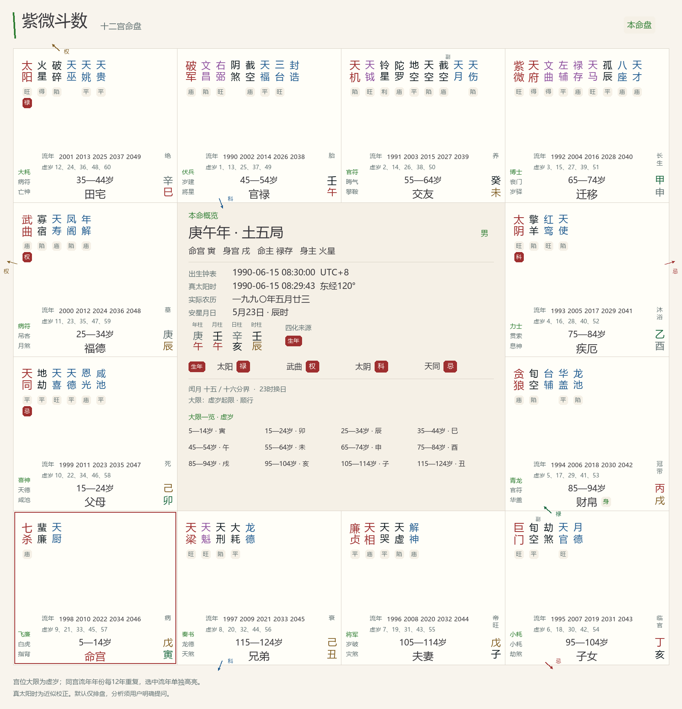
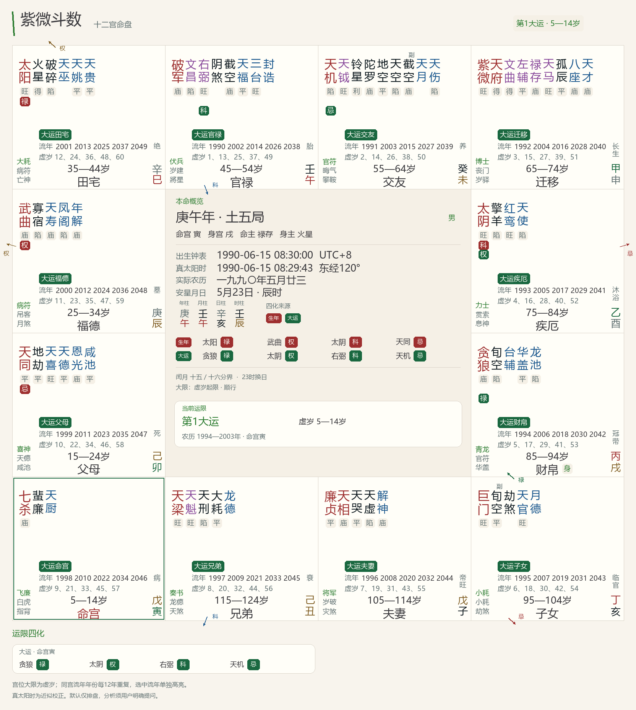
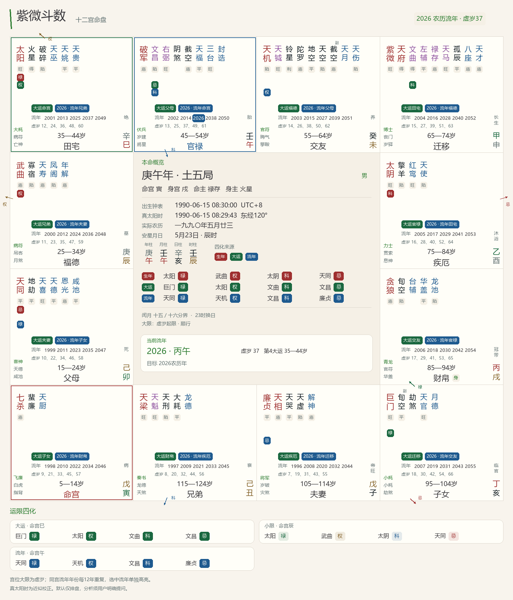
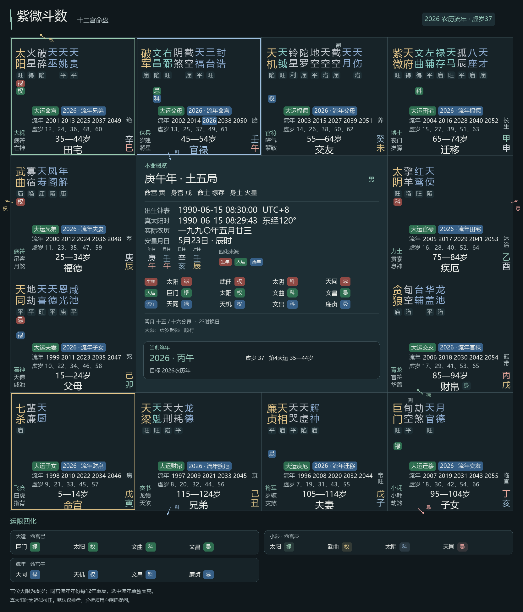
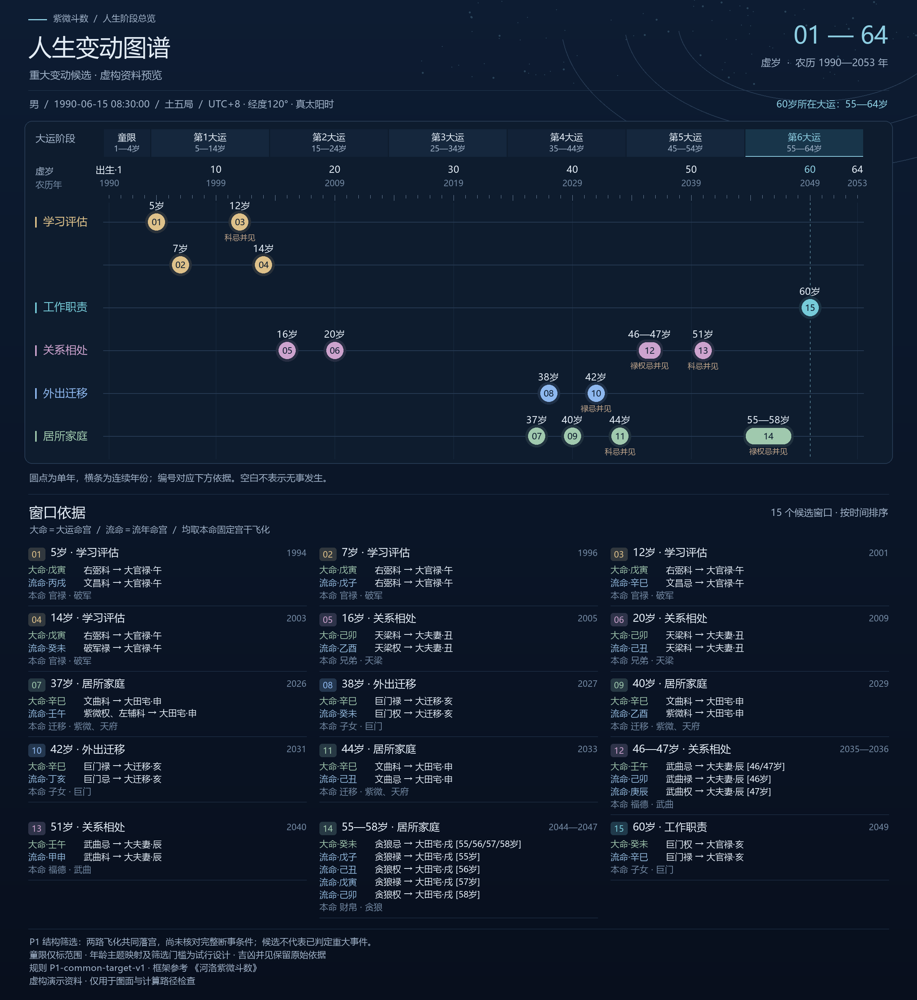

# 紫微斗数排盘

AstrBot 紫微斗数排盘插件，按参考会话提取的文墨天机 2.5.9 安星公式与规则表独立实现。输入出生日期、明确时刻和性别，返回十二宫图片或完整文字盘，支持公历、农历闰月、真太阳时及运限四化。

目录、独立 Git 仓库名与插件标识统一为 `astrbot_plugin_ziwei`，版本 `1.7.2`。排盘计算在本地完成；已开启的群可让 AstrBot 的 LLM 调用排盘与读盘工具。

## 安装

要求 Python 3.10+、AstrBot 4.24.0+。

1. 将整个插件目录放入 AstrBot 的 `data/plugins/`。
2. 在 **AstrBot 实际使用的 Python 环境** 安装依赖：

   ```sh
   python -m pip install -r data/plugins/astrbot_plugin_ziwei/requirements.txt
   ```

3. 在 WebUI 重载插件，检查日志。在目标群由管理员发送 `/紫微 开启`，再发送排盘指令；帮助可通过 `/紫微 帮助` 查看。

Windows 自动查找微软雅黑或黑体，Linux 查找 Noto CJK 或文泉驿，macOS 查找苹方。也可在 WebUI 的 `font_path` 填服务器上中文字体的完整路径。没有可读字体或渲染失败时普通排盘返回文字盘；人生图谱仅支持图片，失败时提示检查配置后重试。

仓库地址：[RioMaker/astrbot_plugin_ziwei](https://github.com/RioMaker/astrbot_plugin_ziwei)。本次版本提供本地安装包，远程安装的版本以仓库已推送内容为准。插件使用平台无关的普通消息和图片组件；真实 AstrBot、QQ／OneBot 及其他平台收发尚待集成验收。

## 指令

`/紫微`、`/紫薇`、`/紫微排盘`、`/紫薇排盘`、`/ziwei` 等效，均支持开关、状态及排盘，例如 `/紫薇 开`、`/紫薇 开启`；命令前缀随 AstrBot 唤醒前缀配置调整。

所有群默认不在使用白名单内。必须在当前群发送开启指令后，群成员才能排盘；私聊不能排盘或管理群授权，AstrBot 管理员也不能绕过群开启要求。帮助可直接查看。

| 群管理指令 | 权限与效果 |
| --- | --- |
| `/紫微 开启` 或 `/紫微 开` | 群主、群管理员或 AstrBot 管理员将当前群加入白名单 |
| `/紫微 关闭` 或 `/紫微 关` | 同上权限，移除当前群授权，拒绝后续新排盘请求 |
| `/紫微 状态` | 任意群成员查看当前群是否已开启 |

授权按“平台实例 ID＋群 ID”隔离，不随发起成员或会话的用户维度变化。开关由 AstrBot 插件 KV 持久化，重启或重载后保留。升级到 1.1.0 后已有群也须首次开启，没有默认放行或 WebUI 绕过开关。读取失败或授权数据异常时拒绝排盘。

QQ／OneBot 可识别原始事件的群主、管理员角色；角色缺失时使用群成员接口查询，8 秒超时或查询失败时拒绝修改开关。其他平台由 AstrBot 管理员开启或关闭。

```text
/紫微 开启
/紫微 1990-06-15 08:30 男
/ziwei 199006150830 男
/ziwei 19900615083045 男
/ziwei 19900615 0830 男
/紫微 19900615 08:30:30 女 文字
/紫微 农历 2023-闰02-16 12:00 女 真太阳时=关
/紫微 1990-06-15 辰时 男 经度=116.4 时区=8
/紫微 1990-06-15 08:30 男 运限=1
/紫微 1990-06-15 08:30 男 大运=2 主题=夜间
/紫微 1990-06-15 08:30 男 流年=2026
/紫微 1990-06-15 08:30 男 主题=夜间
/紫微 1990-06-15 08:30 男 流盘=2026-10-06 流时=10:00
```

以下示例日期均为虚构演示数据。必须给出日期、时刻和性别。默认公历，可显式写 `公历`／`阳历`；农历须写 `农历`／`阴历`。闰月在月份前写 `闰`。性别接受 `男`／`女`、`male`／`female`。时刻接受 `HH:MM`、`HH:MM:SS` 或十二时辰；时辰名采用本时辰的偶数小时作代表（子时 00:00，巳时 10:00），有精确出生时刻时应填钟表时间。

也可把日期与时刻连写：12 位 `YYYYMMDDHHMM` 或 14 位 `YYYYMMDDHHMMSS`，后面用空格填写性别。分开输入时，时刻额外支持 `HHMM`／`HHMMSS`（如 `0830`、`083045`）。各指令别名、LLM 工具与离线入口都兼容；不接受不完整位数或重复时刻，仍严格检查日期与时间。

1.7.2 起，聊天指令也兼容可明确拆分的省空格写法，例如以下虚构资料：

```text
/人生199006150830男
/人生 199006150830男
/紫微图谱199006150830男
/紫薇199006150830男
/人生199006150830男主题=白天
/紫薇开启
```

现有别名均适用，12／14 位日期时间、中文性别和明确的 `名称=值` 选项可相连；不推测缺失日期、时刻或性别。省空格输入格式有误时不发送提醒，也不转交默认 AI 回复。标准空格写法继续显示错误提示；需要诊断时可改用 `/人生 199006150830 男` 等标准格式。群授权、管理权限、已有档案隔离及 AI 额度规则保持一致。仅处理已由 AstrBot 唤醒的消息，不将普通聊天中的“人生感悟”“紫薇花”等词当作指令。

支持输入年份 1900—2100，转换和校正后的公历也须在此范围内。不存在的公历日、农历日或闰月会拒绝，不补造未知出生时刻。

| 选项 | 示例与含义 |
| --- | --- |
| 经度 | `经度=116.4`，东经为正、西经为负；默认 120 |
| 时区 | `时区=8`，当时当地 UTC 偏移小时，可含小数；默认 8 |
| 真太阳时 | `真太阳时=开`／`关`，校正经度和均时差；默认开 |
| 闰月 | `闰月=current`／`next`／`split`，本月／下月／十五十六分界；默认 split |
| 子时 | `子时=next_day`／`midnight`，23 时或零点换日；默认 next_day |
| 输出 | `输出=image`／`text`，也可直接在末尾写 图片／文字 |
| 主题 | `主题=白天`／`夜间`，也接受 `day`／`night`；留空使用 WebUI 的 `image_theme`（默认 day），只影响图片 |
| 运限 | `运限=0` 选择童限，`运限=1`—`12` 选择第几个大限；`大限=`、`大运=` 是同义参数 |
| 流年 | `流年=2026`，指定农历年份，叠加生年、当年所属大运和流年四化，计算大限、小限与流年宫名 |
| 流盘 | `流盘=2026-10-06`，指定公历日期，增加流月、流日、流时 |
| 流时 | `流时=10:00`，目标钟表时刻；流盘未填流时默认 12:00 |

`运限` 与 `流年`／`流盘`／`流时` 不能同时选择；`流年` 与 `流盘` 也互斥。运限盘只叠加所选童限或大限及其四化，不生成一个假定的流年；流年盘自动选取该年所属运限，无需再填写 `运限`。流盘沿用本次出生资料的经度、时区和校正开关，结果显示校正后的目标时间。虚岁按目标农历年减安星农历生年加一，不查询出生前或十二大限范围外的流盘。

图片采用现代东方配色，并参考用户提供的命盘布局：外围为连贯十二宫格，星曜在各宫顶部竖排，宫名和大限年龄在底部，宫干支和长生在右侧，十二神在左侧；中央集中显示出生资料、紧凑四柱和所选层级的四化。四柱仅占四列小区域，标示年柱、月柱、日柱、时柱，天干在上、地支在下，各字按自身五行着色。本命盘中央附十二大限一览；运限盘显示所选童限或大运的虚岁、农历年份范围；流年盘显示年份、干支、虚岁与所属大运，日期流盘另显示目标时间。各宫保留本命宫名，并列出已选大运、流年的宫名。文字盘仍提供全部已计算层级和四化。

| 显示类别 | 白天：宣纸色底 | 夜间：深青墨色底 |
| --- | --- | --- |
| 十四主星 | 红色 | 暖金 |
| 文昌文曲、辅弼、魁钺、禄存与天马 | 紫色 | 浅青 |
| 羊陀火铃空劫及天刑、天空、空曜、阴煞、劫煞等凶煞标记 | 墨黑 | 暗白 |
| 其余杂曜 | 蓝色 | 雾蓝 |

星名颜色表示类别，不随四化变化。顶部不再显示主星、辅星等分类注释。庙旺为灰色独立标记；星曜处的四化只显示 `禄、权、科、忌` 单字，不添加生／运／年前缀。生年、大运、流年分别用红、绿、蓝三种底色区分来源，同一星曜的各层标记分开排列；宫内来源标签和中宫四化说明使用相同的来源颜色。夜间使用适合深色背景的独立色值。自化箭头沿用禄青绿、权金色、科蓝色、忌红色，独立于这三种来源底色。

向心、离心自化只在宫界边线上画箭头，不在星曜旁重复显示。离心在外围框线指向外侧，向心在靠盘心的内框线指向盘心；箭头保留跨越宫界的表达，不移到宫内。多个箭头分开排布，字样与线段留出间隔，避开宫名及相邻文字。文字盘与 LLM 数据仍明确保留各层四化及离心、向心名称。副星另标 `副`，身宫标 `身`。

中宫四柱与每宫右下角的天干、地支分别按自己的五行着色：甲乙寅卯为木，丙丁巳午为火，戊己辰戌丑未为土，庚辛申酉为金，壬癸亥子为水。白天使用青绿、红、赭黄、银灰、墨黑，夜间使用浅青、珊瑚、沙金、银白、灰蓝。四柱区域只显示柱名和干支，不加入藏干、生克箭头或八字起运信息。

沿用原中文字体和常规字重，保持宫格尺寸。主星字号最高 32，辅杂曜 29，庙旺与四化标记 18；宫内运限标签、流年年份、虚岁、十二神、长生与身宫标记均为 18，干支 26，副星标记 16，宫界自化字样 15。星列间距略微收紧，密集星列按列宽调整，完整保留所有星曜。中心出生资料字号 26，宫名字号 30。白天配色基于[中国传统色色卡](https://github.com/nevertoday/zhongguo-traditional-colors/blob/main/docs/chinese-color-master-list.md)组合，局部灰色为文字对比度略调；夜间为本插件独立设计的色卡。准确色值见 `themes.py`。

每宫列出对应的农历流年年份与虚岁序列，同宫每十二年重复，最多显示五个年份。本命盘从出生后开始列出，流盘围绕所选年份展示；年份限制在本盘运限及 1900—2100 支持范围内。所选年份在对应宫位单独高亮，并显示 `2026 · 流年命宫` 等当年宫名，方便同时识别本命宫与流年宫。

以下预览采用虚构演示资料 `1990-06-15 08:30 男`，使用插件默认规则；运限示例选择第一个大限，流盘示例选择 2026 农历年。所有示例日期均为演示数据，请替换为实际需要排盘的资料。









## 人生变动图谱

`/人生` 与 `/紫微 图谱` 使用同一处理流程，支持 12 位 `YYYYMMDDHHMM`、14 位 `YYYYMMDDHHMMSS`，以及分开的日期、时刻与性别。以下仍为虚构演示资料：

1.7.1 修复了 `/人生` 入口在 AstrBot 参数绑定时只接收第一个词的问题；从 1.7.0 更新后需重载插件，使完整的出生日期、性别及选项正确传入。

```text
/人生 199006150830 男
/紫微 图谱 199006150830 男
/人生 19900615083045 男
/人生 1990-06-15 08:30 男 主题=白天
/人生 帮助
```

输出一张深蓝星图风格 PNG，按时间轴与学习、工作、关系、迁移、居所主题汇总候选变动窗口，下方按编号显示宫位与两路飞化依据。默认夜间主题，独立于普通排盘的全局主题和文字输出设置；显式 `主题=白天` 可改用浅色。保留经度、时区、真太阳时、农历等出生选项，不接受 `流年`、`流盘`、`流时`、`运限`／`大限`／`大运` 或文字输出。

范围从出生所在农历年（虚岁 1）到包含 60 虚岁的整段大运末年，不固定截在 60 岁。终点随五行局为 61—65 虚岁；示例土五局覆盖 1—64 虚岁、1990—2053 农历年。童限保留时间段但不生成事件窗口；整段范围超出 1900—2100 年计算支持时明确拒绝，不截短图片。

无参数的 `/人生` 或 `/紫微 图谱` 优先使用本人当前缓存命盘。缓存没有选择时，若本群仅有一种出生资料与规则配置，则读取其最新档案；多份命盘会列出本人的选择指令。可用 `/人生 命盘=<本人命盘ID> 主题=夜间` 明确指定，命盘 ID 不与出生参数混用。流年或运限档案会提取本命副本生成图谱，原档案及缓存仍保留其原有层级。

两个入口均要求当前群已 `/紫微 开启`，私聊及管理员身份不能绕过授权；只读取当前真实事件的平台实例、群和用户所属档案。直接图谱指令不消耗 AI 排盘或解盘额度，生成成功后将本命来源、窗口依据、规则和知识快照归档到插件数据目录；不调用 LLM 分析或总结。

目前图谱沿用已确认预览的 **P1 结构筛选**：大运命宫与流年命宫从不同宫位发出的本命宫干飞化，共同落入指定大运主题宫时标记候选窗口。它是自定筛选规则，尚未完整判断文献条件、星情及现实情境，不能当作已经断定的重大事件或发生概率；未标记也不表示该年没有事情发生。具体条件和来源边界见 [实现说明](references/IMPLEMENTATION.md#人生变动图谱-p1)。



## LLM 排盘与读盘

群管理员先在当前群执行 `/紫微 开启`。默认排盘只展示计算结果并归档；只有用户明确提问，AI 才查询对应的本命、大运或流年资料分析。当前 AstrBot 模型须支持工具调用，并允许使用下列工具。插件使用已有 AstrBot 模型配置，反馈闭环后另以独立空上下文调用总结模型。

| 工具 | 参数 | 功能 |
| --- | --- | --- |
| `ziwei_paipan` | `birth_info`、`send_image`（默认 false） | 使用与指令相同的出生资料格式排盘，返回完整结构化结果；明确需要图片时可同时发送到当前群 |
| `ziwei_get_chart` | `chart_id`、`palace`（均可留空）、`send_image`（默认 false） | 读取本人最近盘或指定历史快照，按本命宫名筛选；可重发完整图片，无需重新排盘 |
| `ziwei_list_archives` | `offset` | 分页列出本人命盘 ID 及当前分析状态 |
| `ziwei_analysis_context` | `chart_id`、`scope`、`topic` | 登记当前真实问题，返回所问范围的计算关系及文献总结 |
| `ziwei_query_knowledge` | `reading_id`、`offset` | 分页查询同一分析范围的文献条目 |
| `ziwei_continue_reading` | `reading_id`、`kind` | 登记当前相关追问或反馈，读取原分析资料 |
| `ziwei_finish_reading` | `reading_id`、`feedback_complete` | 主 AI 判断反馈闭环后，排队独立总结并立即返回 |
| `ziwei_reading_history` | `chart_id`、`offset` | 查询本人同一命盘族的已闭环摘要及反馈，仅内部参考 |
| `ziwei_reference_cases` | `reading_id` | 查询匹配的其他用户脱敏案例，仅内部参考 |
| `ziwei_retry_summary` | `reading_id` | 用户要求重试时，重新排队本人失败的总结 |

以下均为虚构演示，可在已开启的群中对 LLM 说：

```text
请按公历1990-06-15 08:30，男，排紫微盘并解释命宫。
请读取我刚才的盘，看看夫妻宫有哪些星和四化。
请按上述资料排第一个大限的运限盘，并给我图片。
请按上述资料排2026流年盘，并给我排盘图片。
```

手动 `/紫微` 和 LLM 每次成功排盘均创建独立档案 ID，不覆盖旧盘。相同原始出生参数、规则版本及配置归为一个命盘族，便于查看历次运限与反馈。排盘工具只返回计算事实；出生日期、具体时刻或性别缺失时须询问用户，不得代用帮助示例。

`scope` 为 `natal`（生年本命）、`decade`（所选大运）或 `annual`（指定农历年）。大运与流年分析必须先排对应类型的盘；缺少目标先询问，不默认猜选。`topic` 支持整体、事业、财、感情、家庭、子女、交友、健康、学业、迁移、田宅和福德。每次回答关联一个命盘、一个作用域和主题，防止问答串档；日期盘的月日时不进入本期分析资料。

AI 工具按每位用户的**滚动一小时**限制：解盘提问最多 **6 次**、生年排盘最多 **2 张**、大运排盘（含童限）最多 **3 张**，三项分别计数。同一平台实例的同一账号跨群共享额度，插件重载和群开关不会重置。流年排盘不新增次数限制，其解盘提问仍计入 6 次额度。

解盘以真实用户消息为一次提问：新分析、追问以及新消息中的知识或历史参考查询均计数；同一消息的重复工具调用和分页只计一次。纯反馈、闭环归档、重试总结、列出命盘、读取和重发已有命盘不扣次数。达到上限返回 `rate_limited` 及 `retry_after_seconds`，AI 应停止本轮新增分析，不能借旧上下文或指令代执行绕过限制。

直接使用 `/紫微` 等指令排盘不受上述次数限制，仍需群授权并遵守原并发限制。重发旧盘调用 `ziwei_get_chart(send_image=true)`，使用当前默认主题渲染原快照，不新增档案、不重新计算。参数或计算失败不扣排盘额度；已成功归档但图片发送失败仍计一次，可免费重发。

两本资料已整理为 65 条可程序检索的总结，覆盖方法、星情、宫位、四化与分层飞化路径，保留页码／篇章段落、适用条件和例外。全书与河洛口径分开；尚未实现的独立限流曜规则被标为不可用。详见 [知识库说明](knowledge/README.md) 和 [归档与反馈协议](references/READING_ARCHIVE.md)。

返回值是 JSON，包含 `status`、`chart_id`、`expires_in_seconds`、`data` 与字段说明。`data` 提供规则版本与配置快照、原始及换算出生资料、四柱、命身宫、五行局、十二宫星曜、庙旺、正副星、各层四化和自化、十二神、童限与十二大限、所选运限或流盘。各星仅在所属宫位列出一次。图片中的大运在后端字段中称为 `大限`，其算法和来源一致。运限盘的 `flow.kind` 为 `decade`，含起止年份、完整 `decade` 与仅含大限的 `layers`，`year`、`target` 为 null；流年及日期流盘的 `flow.kind` 为 `annual`。按宫筛选仍保留整体摘要和运限，`palace` 指本命宫名；需要分析大运或流年宫时可取完整盘并读取 `flow_names`。

每次工具调用都检查真实事件的群授权，LLM 无法指定其他群／用户、开启群功能或绕过私聊限制。关闭后拒绝后续读取并清除本群缓存；正在计算的任务在返回前再次复核授权。管理员身份也不能绕过未开启状态。

内存缓存按平台实例、群、发送者隔离，最多 128 份，有效期 15 分钟；读取不续期，关闭或重载清除。缓存过期后回查永久档案，因此 `expires_in_seconds=0` 不代表档案删除。没有本人对应档案返回 `not_found`，权限不足返回 `denied`，参数错误返回 `invalid_input`，繁忙返回 `busy`，组件异常返回 `unavailable`。

档案保存在 AstrBot 数据目录的 `plugin_data/astrbot_plugin_ziwei/archives.sqlite3`，位于插件代码目录之外，更新插件不覆盖它。每盘保存计算快照；分析保存关联问题、实际发送的文字回答、用户反馈、所用文献快照及独立总结。普通聊天不自动记入案例。插件不将生辰写入 KV 或输入日志，AstrBot 自身聊天历史仍由框架管理。

主 AI 确认用户反馈闭环后调用结束工具；程序要求已有回答及后续真实反馈。总结后台使用一次独立模型请求，结果直接存档，不加入主对话；没有反馈则保持未完成。`summary_provider_id` 可指定已有模型，留空使用该会话当前模型。跨用户查询不返回自由文本、出生资料或档案 ID，只返回匹配特征和反馈分类；不足三个其他用户的匹配案例时不返回共享结果。AI 被要求不得披露历史参考内容或统计，不把反馈分类当作准确率。

工具通过 [AstrBot 官方 `llm_tool` 装饰器规范](https://docs.astrbot.app/dev/star/guides/ai.html) 注册，参数使用框架要求的 `Args:` 类型说明；模型及事件接口核对日期 2026-10-14。

## 配置与计算范围

WebUI 的 `_conf_schema.json` 提供字体、输出、历法、四化变体及安星配置。默认使用三合天盘基础公式：闰月十五／十六分界、晚子时换日、全书七级庙旺、第一魁钺表、正副截空旬空、年马、命宫支取命主、阴阳性别顺逆长生、水土共长生。

默认生成 70 个本命星曜实例（主星、辅星、三合杂曜及正副空曜）；长生、博士、岁前、将前独立保存。运限含童限、十二大限、小限和年、月、日、时宫名与本命星四化。此版尚未生成独立的限流曜集合，也未实现原程序三模式门控、天地人盘、定盘、安星码、四柱反查或八字起运；本插件档案格式与原程序命例库不同。具体差异见 [实现与规则边界](references/IMPLEMENTATION.md)。

历法使用 `lunar-python 1.4.8`，真太阳时使用独立 Meeus 近似计算。没有打包原程序源码、历法 JavaScript、EXE、字体或 UI 资源，未宣称全盘与原软件逐秒相同。见 [来源记录](references/provenance.json)、[验证记录](VERIFICATION.md)、[第三方说明](THIRD_PARTY_NOTICES.md)。

仅群授权开关通过框架 KV 保存；命盘、问答与总结使用上述独立 SQLite 档案。关闭群功能暂停档案访问和总结队列，重新开启可继续，关闭及重载不会删除档案。群聊盘面会显示出生日期。图片在内存生成，插件代码目录不写运行数据。手动与工具排盘共享最多两个计算并发、四个排盘请求在途，超过时提示稍后重试；独立总结使用单消费者队列。

## 离线预览与验证

在插件目录执行，离线预览不依赖 AstrBot：

```sh
python -m pip install -r requirements-dev.txt
python scripts/preview.py "1990-06-15 08:30 男" --output .dev/natal-preview.png
python scripts/preview.py "1990-06-15 08:30 男 运限=1" --output .dev/decade-preview.png
python scripts/preview.py "1990-06-15 08:30 男 流年=2026" --output .dev/annual-preview.png
python scripts/preview.py "1990-06-15 08:30 男 流盘=2026-10-06 流时=10:00" --output .dev/flow-preview.png
python scripts/preview.py "1990-06-15 08:30 男 主题=夜间" --output .dev/night-preview.png
python scripts/preview.py "1990-06-15 08:30 男" --json --output .dev/chart.json
python scripts/preview.py "1990-06-15 08:30 男 文字" --output .dev/chart.txt
python scripts/preview_life_atlas.py "199006150830 男" --output .dev/life-atlas.png
python scripts/preview_life_atlas.py "199006150830 男 主题=白天" --output .dev/life-atlas-day.png
python scripts/preview_life_atlas.py "199006150830 男" --json --output .dev/life-atlas.json
python -m ruff format --check .
python -m ruff check .
python -m pytest -q
```

命令行导出由调用者指定保存位置，插件自身不持久化导出。

## 来源

- 参考会话 `逆向文墨天机程序`，ID `01a1101e-078d-7071-befc-919cf9031da1`，2026-10-06 提取的 2.5.9 文档。
- [AstrBot 消息事件](https://docs.astrbot.app/dev/star/guides/listen-message-event.html)、[插件配置](https://docs.astrbot.app/dev/star/guides/plugin-config.html)、[GreedyStr 源码](https://github.com/AstrBotDevs/AstrBot/blob/master/astrbot/core/star/filter/command.py)，核对日期 2026-10-06。
- [lunar-python](https://github.com/6tail/lunar-python)，MIT 许可。
- 均时差采用 [NOAA 所说明的 Meeus 太阳计算方法](https://gml.noaa.gov/grad/solcalc/calcdetails.html) 的独立近似实现。
