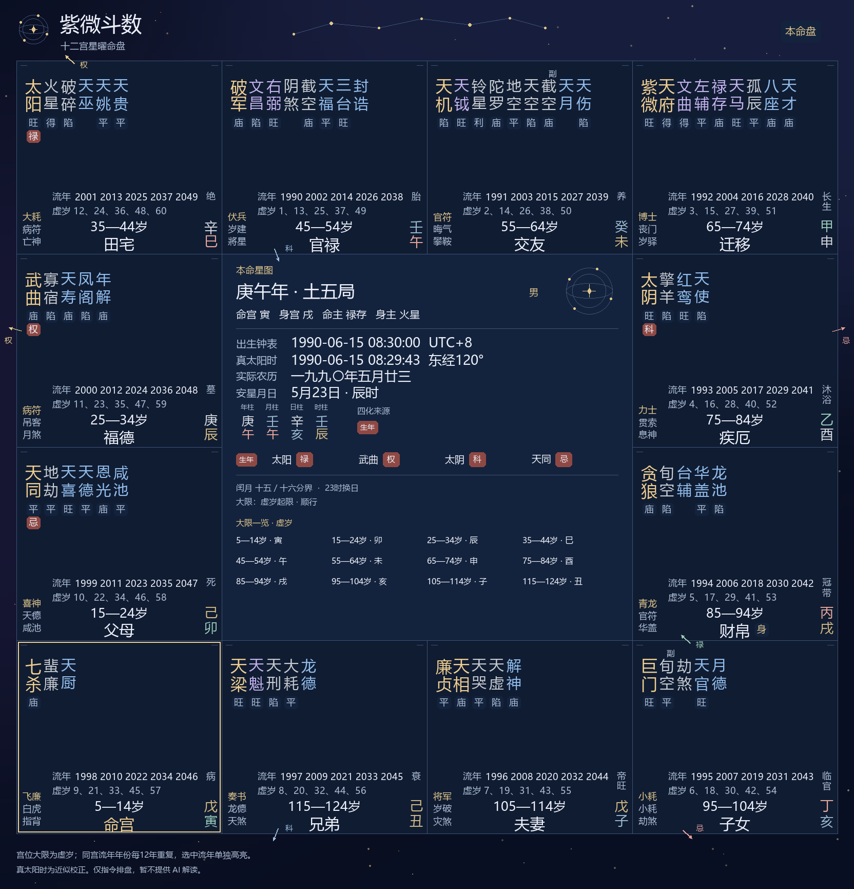
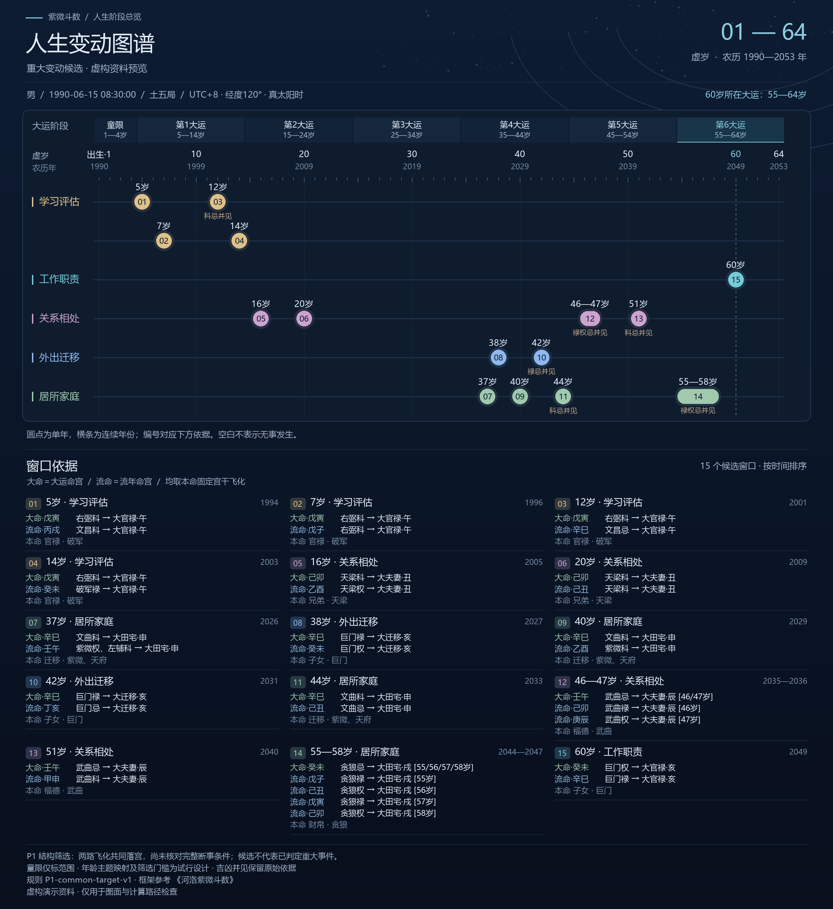

# 紫微斗数排盘

AstrBot 紫微斗数插件，版本 **2.0.1**。在已授权群内通过指令输入出生资料，返回星空风格十二宫命盘；也提供图片帮助、运限盘、流年盘、日期流盘和原有指令版人生图谱。

**当前仅支持指令排盘，暂不提供 AI 看盘、AI 排盘或辅助定盘。** 不注册 LLM 工具、不注入对话提示、不调用模型、不启动后台总结。历法和安星引擎沿用原实现，本次重构不调整落星公式或规则表。

## 安装与升级

要求 Python 3.10+、AstrBot 4.24.0+。

1. 将整个目录放入 AstrBot 的 `data/plugins/astrbot_plugin_ziwei/`。
2. 在 AstrBot 使用的 Python 环境安装依赖：

   ```sh
   python -m pip install -r data/plugins/astrbot_plugin_ziwei/requirements.txt
   ```

3. 重载插件，在目标群由群主、群管理员或 AstrBot 管理员发送 `/紫微 开启`。
4. 发送 `/紫微` 查看图片帮助；`/紫微 帮助 文字` 获取可复制的说明。

新安装默认 `image_theme=night`，使用深蓝星空模板。升级会保留已有主题；如果原配置为 `day`，在 WebUI 改为 `night`，或单次加 `主题=夜间`。原字体、输出、经度时区和安星规则配置继续有效。旧 AI 配额及总结模型配置已从设置面板移除，遗留配置不触发任何 AI 功能。

原命盘、图谱、读盘、反馈、定盘候选和额度记录保留在 AstrBot 数据目录的 `plugin_data/astrbot_plugin_ziwei/archives.sqlite3`。2.0.0 不恢复或推进旧 AI 总结任务，也不提供旧 AI 记录的聊天入口。更新前可停用插件并备份整个插件数据目录。旧 AI 服务源码、离线预览和存储回归仍保留供兼容维护，未接入当前插件入口。

字体继续使用常规字重中文字体：Windows 查找微软雅黑／黑体，Linux 查找 Noto CJK／文泉驿，macOS 查找苹方，也可配置 `font_path`。命盘或帮助图片生成失败时返回文字；人生图谱生成失败会提示检查字体后重试。图片通过 AstrBot 消息组件返回，不依赖浏览器、图片服务或模型。

## 指令

所有日期均为虚构演示资料，请替换为需要排盘的出生资料。

```text
/紫微 开启
/紫微
/紫微 1990-06-15 08:30 男
/ziwei 199006150830 男
/ziwei 19900615083045 女
/紫微 农历 2023-闰02-16 12:00 女 真太阳时=关
/紫微 1990-06-15 08:30 男 经度=116.4 时区=8
/紫微 1990-06-15 08:30 男 运限=1
/紫微 1990-06-15 08:30 男 大运=2 主题=夜间
/紫微 1990-06-15 08:30 男 流年=2026
/紫微 1990-06-15 08:30 男 流盘=2026-10-06 流时=10:00
/紫微 1990-06-15 08:30 男 文字
/紫微 帮助 文字
```

`/紫微`、`/紫薇`、`/紫微排盘`、`/紫薇排盘`、`/ziwei` 等效。前缀随 AstrBot 唤醒配置调整。出生日期、时刻、性别必须明确；不推测缺失资料。

| 指令 | 用途 |
| --- | --- |
| `/紫微` 或 `/紫微 帮助` | 星空图片帮助，私聊和未授权群也可查看 |
| `/紫微 帮助 文字` | 可复制的完整文字帮助 |
| `/紫微 开启`／`开` | 管理员在本群开启排盘 |
| `/紫微 关闭`／`关` | 关闭本群排盘并清空本群内存缓存 |
| `/紫微 状态` | 查看本群开关 |
| `/人生 <日期 时刻 性别>` | 原有的指令版人生图谱，也可用 `/紫微 图谱` |
| `/紫微 定盘` | 告知辅助定盘当前不可用，不创建候选 |

所有群默认未授权。私聊不能排盘，AstrBot 管理员也不能绕过本群开关。群开关按平台实例＋群隔离并持久化。QQ／OneBot 支持群主、群管理员管理开关；其他平台使用 AstrBot 管理员身份。每个有效指令均停止后续处理并禁止默认模型接管；普通聊天不会触发排盘。

日期时间支持 12 位 `YYYYMMDDHHMM` 或 14 位 `YYYYMMDDHHMMSS`，也可分开填写 `HH:MM`、`HH:MM:SS`、`HHMM`、`HHMMSS` 或十二时辰。时辰名使用该时辰偶数小时作为代表；有精确时间时应填钟表时间。农历须加 `农历`／`阴历` 前缀，闰月标 `闰`。支持 1900—2100 年，不存在的日期拒绝处理。

兼容 `/紫微199006150830男`、`/人生199006150830男`、`/紫薇开启` 等可明确拆分的省空格写法。省空格输入有误时静默忽略且不转交模型；标准空格写法会返回错误提示。

| 选项 | 含义 |
| --- | --- |
| `经度=116.4` | 东经为正、西经为负；默认 120 |
| `时区=8` | 出生当时实际 UTC 偏移，含当时夏令时；默认 8 |
| `真太阳时=开`／`关` | 经度及均时差近似校正；默认开 |
| `闰月=current`／`next`／`split` | 本月／下月／十五十六分界；默认 split |
| `子时=next_day`／`midnight` | 23 时或零点换日；默认 next_day |
| `主题=夜间`／`白天` | 深蓝星空／浅色星图，也接受 night／day；只影响图片 |
| `输出=image`／`text` | 图片／文字；也可直接加“图片”或“文字” |
| `运限=0`—`12` | 0 为童限，1—12 为大限序号；`大限=`、`大运=` 同义 |
| `流年=2026` | 农历流年，自动包含对应大限、小限及流年宫名 |
| `流盘=2026-10-06` | 公历目标日期，增加流月、流日和流时 |
| `流时=10:00` | 与流盘搭配，省略时为 12:00 |

运限不与流年、流盘或流时混用；流年和流盘也互斥。纯运限盘不生成假定流年或目标时间。流盘沿用本次资料的经度、时区和校正规则，虚岁按农历年计算。

## 星空模板

命盘与帮助采用统一的深蓝底色、淡金星点、细线星座和星轨纹样。装饰为程序绘制，不是实际出生时刻的天文星图，不参与排盘计算。浅色主题继续保留，主题按每次请求独立传入。

十二宫环绕中宫，星曜竖排，宫名与大限年龄位于底部。中央显示出生资料、紧凑四列四柱和各层四化。沿用原中文字体及常规字重，星名统一为 36 像素，星名、庙旺、四化和“副”标记按同一列中心对齐。每排最多九列；密集宫自动换排，只增加所在宫格行的高度，完整保留所有星曜。

图面分为五类，顶部提供颜色图例；这里的“辅星”是单列六吉、六煞后的其余辅星，不改写计算引擎分类。

| 类别 | 星曜范围 | 夜间 | 白天 |
| --- | --- | --- | --- |
| 主星 | 紫微等十四主星（含七杀、破军） | 暖金 | 红 |
| 六吉 | 文昌、文曲、左辅、右弼、天魁、天钺 | 青绿 | 深绿 |
| 辅星 | 禄存、天马 | 浅紫 | 紫 |
| 六煞 | 擎羊、陀罗、火星、铃星、地空、地劫 | 暗白 | 墨黑 |
| 杂曜 | 其余已显示的杂曜，含截空、旬空 | 浅蓝 | 蓝 |

**“副”是什么意思？** 默认空曜取法为“正副双星”（`void_rule=2`），截空、旬空各有正空和副空两个落宫位置；“副”表示该星是副空实例，未标“副”的是正空。它不是“辅星”分类，也不是强弱评级，程序不会据此将星曜权重减半。该标记仅用于截空、旬空，图面和文字盘均保留，其他空曜取法沿用各自规则。

四化只显示禄权科忌单字，生年／大运／流年分别用红／绿／蓝底色区分；类别颜色与四化来源分开。干支逐字按五行着色。颜色只区分显示类别，不是独立的吉凶判定。

离心、向心自化仍只画在对应宫界，内框箭头在中宫背景之后绘制。农历流年标在对应年支宫位，所选年份单独高亮。表头星空装饰避开星曜和宫界箭头。

以下预览使用虚构 `1990-06-15 08:30 男`；密集盘使用虚构 `农历 1993-10-25 20:00 男`。




其他预览：[大运盘](assets/preview-decade.png)、[流年盘](assets/preview-flow.png)、[夜间流年盘](assets/preview-night.png)、[浅色盘](assets/preview-day.png)、[密集星曜盘](assets/preview-dense.png)。

## 人生图谱与档案

`/人生` 和 `/紫微 图谱` 保留原有确定性计算，不调用模型。填写出生资料会生成图片；无参数时优先读取本人当前缓存，多个出生资料且无当前选择时列出本人档案选择指令，也可用 `/人生 命盘=<本人命盘ID>`。

图谱默认深色，可指定 `主题=白天`，不接受运限、流年、流盘或文字输出。范围为出生到 60 虚岁所在大运末年；童限仅保留时间段。现有 P1 规则标记结构候选窗口，不能视作已发生事件或概率。详见[规则说明](references/IMPLEMENTATION.md#人生变动图谱-p1)。



每次成功排盘在插件外归档，按平台实例、群、用户隔离；群关闭或重载清空短期缓存，不删除永久记录。KV 只存群授权，日志不记录生辰输入。当前指令不会消耗或清理历史 AI 用量。档案结构见[归档协议](references/READING_ARCHIVE.md)，其中旧版 AI 流程仅作为历史文档保留。

## 开发与验证

`main.py` 只适配指令、群权限、排队和交付；`commands.py` 解析参数；`calendar_core.py`、`rules.py`、`engine.py` 负责历法与纯计算；`modern_renderer.py`、`starfield.py`、`help_renderer.py` 负责图片。帮助图片与文字共用 `help_content.py`。图片只在内存生成，计算和渲染在线程中执行，普通排盘与图谱共享并发上限。

参考同工作区六爻插件的分组帮助、图片优先和文字降级方式，星空装饰与版式由本插件独立实现，未复制竹纹图片或字体资源。

```sh
python -m pip install -r requirements-dev.txt
python scripts/preview.py "1990-06-15 08:30 男 流年=2026" --output .dev/flow.png
python scripts/preview_templates.py
python scripts/preview_life_atlas.py "199006150830 男" --output .dev/life-atlas.png
python -m ruff format --check --no-cache .
python -m ruff check --no-cache .
python -m pytest -q -p no:cacheprovider
```

`preview_templates.py` 只使用脚本内固定的虚构资料，重建可分发预览；不访问运行档案或网络。已有测试中的历史存储、额度和离线总结验证，不表示当前插件开放这些 AI 功能。现行入口另有无模型调用、旧任务不恢复及群权限回归。

本地验证见 [VERIFICATION.md](VERIFICATION.md)。尚未进行本次版本的真实 AstrBot／QQ／OneBot 联调；未完成原软件全盘 GUI 比对，不将公式样例验证等同于原软件验证。

## 计算来源

沿用从参考会话文档提取的文墨天机 2.5.9 三合天盘基础公式；具体规则、配置差异、支持范围和未实现能力见[实现说明](references/IMPLEMENTATION.md)。历法使用 [lunar-python](https://github.com/6tail/lunar-python)，均时差采用 NOAA 所述太阳计算方法的独立近似实现。第三方说明见 [THIRD_PARTY_NOTICES.md](THIRD_PARTY_NOTICES.md)。

仓库：[RioMaker/astrbot_plugin_ziwei](https://github.com/RioMaker/astrbot_plugin_ziwei)。本地提交不代表已推送或部署。
